<a href="https://github.com/tanzeeldevAi/google-business-profile-ai-automation"><picture><source media="(prefers-color-scheme: dark)" srcset="./cards/gbp-dark.svg"></picture></a><a href="https://github.com/tanzeeldevAi/whatsapp-ai-chatbot-support-agent"><picture><source media="(prefers-color-scheme: dark)" srcset="./cards/whatsapp-dark.svg"></picture></a>
<a href="https://github.com/tanzeeldevAi/linkedin-automation-ai-agent"><picture><source media="(prefers-color-scheme: dark)" srcset="./cards/linkedin-dark.svg"></picture></a><a href="https://github.com/tanzeeldevAi/reddit-lead-generation-ai-agent"><picture><source media="(prefers-color-scheme: dark)" srcset="./cards/reddit-dark.svg"></picture></a>
<a href="https://github.com/tanzeeldevAi/upwork-ai-proposal-bot"><picture><source media="(prefers-color-scheme: dark)" srcset="./cards/upwork-dark.svg"></picture></a><a href="https://github.com/tanzeeldevAi/zara-ai-laptop-agent"><picture><source media="(prefers-color-scheme: dark)" srcset="./cards/zara-dark.svg"></picture></a>

<a href="https://github.com/tanzeeldevAi?tab=overview"><picture><source media="(prefers-color-scheme: dark)" srcset="./cards/graph-dark.svg"></picture></a>

There is more in the [repositories tab](https://github.com/tanzeeldevAi?tab=repositories), including a tool that turns any video into a transcript an AI assistant can read, and a few website demos.

These cards are SVG, drawn by <a href="./scripts/render_cards.py">one Python script</a> and redrawn every morning from live GitHub data.
